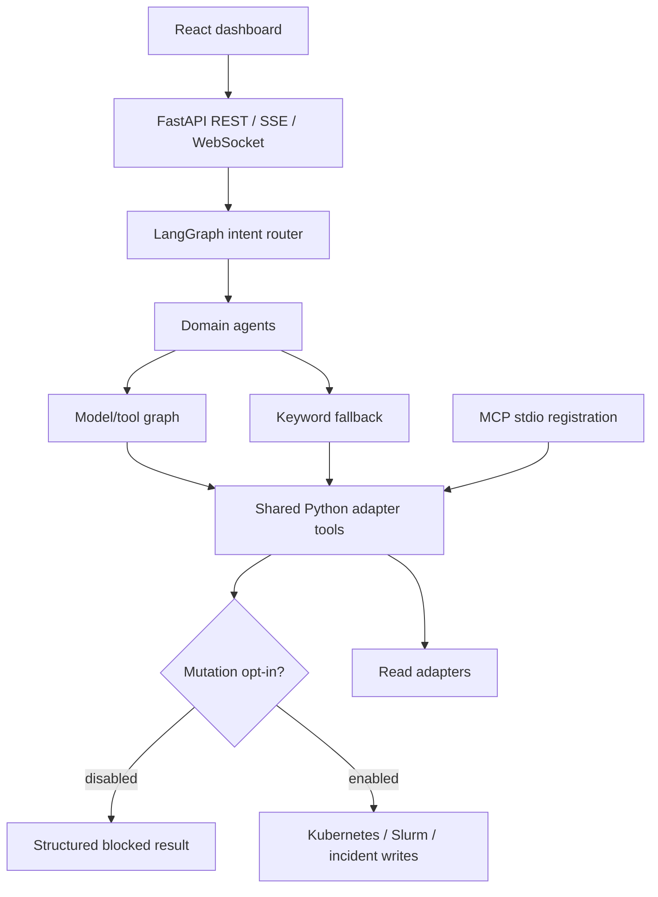

# Architecture and design decisions

## System boundaries

The API and agents call adapters in-process; MCP decorators additionally register the same functions for independent stdio servers. Kubernetes uses its Python client, GPU tools inspect locally available backends, Slurm uses command-line tools, and incident adapters use HTTP clients. This is not a deployed distributed MCP service mesh.

## Decision 1: enforce mutation policy inside tools

**Requirement:** a model, keyword fallback, or direct MCP client must not change infrastructure in the default configuration.

**Choice:** each of the 13 mutating adapter functions calls `blocked_mutation()` before resolving clients or executing external operations. The guard reads the central settings object and returns a structured JSON error with a stable code. It covers Jira creation as well as destructive operations: non-destructive writes still change external state.

**Alternatives:** a system prompt is advisory; a guard only in the model's dispatcher misses keyword fallback and direct invocation; MCP annotation hints describe tools but do not authorize execution. A shared decorator would reduce repetition but requires preserving introspected signatures and registration order. Explicit calls keep the boundary inspectable and testable.

**Tradeoff:** this is a process-wide opt-in. It cannot distinguish users or authorize one proposed operation. Once enabled, all these tools may write with the process credentials. Per-action approval must bind the tool name and validated arguments to an authenticated operator and an expiring approval record before the process can be exposed to others.

## Decision 2: validated graph state and dictionary updates

**Requirement:** model-selected tools must run through the graph and return observable results rather than silently falling back after a type error.

**Choice:** graph nodes receive the declared Pydantic `AgentState` and access its attributes. Nodes return dictionary updates, as LangGraph expects. The regression test compiles the actual graph with a scripted model, requests a real tool wrapper, and verifies the blocked `ToolMessage` without a network call.

**Alternative:** a dictionary-only state schema would also work, but changes the established schema unnecessarily. Previously calling `.get()` on the Pydantic model raised before tool execution, hiding the error behind keyword fallback.

## Decision 3: graceful disconnected inspection

**Requirement:** developers without a cluster or GPU should be able to inspect the interface and adapter failure behavior honestly.

**Choice:** report backend unavailability instead of inventing infrastructure observations. Keyword routing offers limited deterministic functionality when model inference is unavailable; the result retains raw tool output for inspection.

**Tradeoff:** a disconnected screen is less dramatic than a fabricated fleet but does not establish live hardware integration. An explicitly labeled, fixture-driven demo could be added separately. Model-generated explanations are not a source of truth; inspect the adapter data.

## Decision 4: local development before hosting

**Requirement:** reproducible installation and a small, reviewable operating scope.

**Choice:** use committed Python/npm lockfiles, a loopback-bound API, local configuration, isolated adapter tests, and a wheel-install smoke check. Include the root `config` and `platform_detect` modules in the wheel so imports do not depend on the source checkout.

**Tradeoff:** no production deployment claim. Authentication, rate limiting, durable audit storage, multi-user isolation, and live integration validation remain separate work. Configuration fields bearing those names are not implementations. Container files are retained as experimental and have not been verified by this pass; the local commands in the README are the supported demonstration path.

## Verification boundary

The automated gate tests mocked adapter behavior, the real compiled model/tool graph with a scripted model, policy coverage, and dashboard compilation. It does not evaluate a live model, GPU hardware, an external issue tracker, or a production Kubernetes cluster. No throughput, cost, model-quality, or fleet-size claim follows from these tests.
